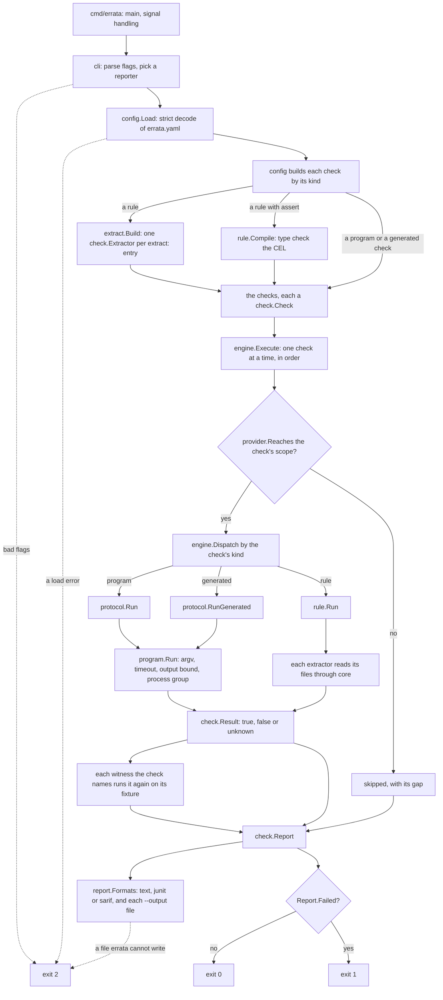
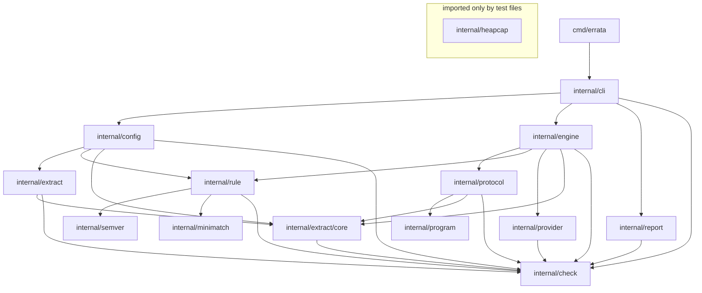
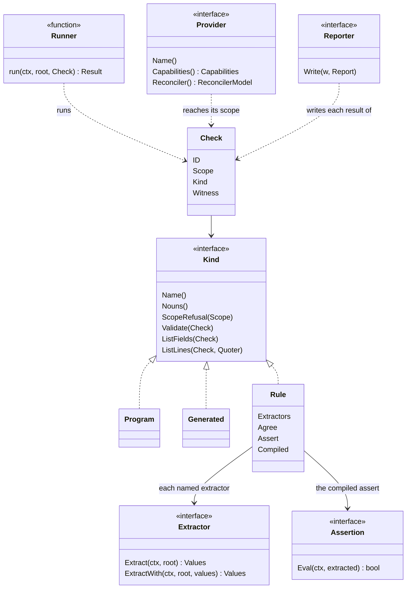
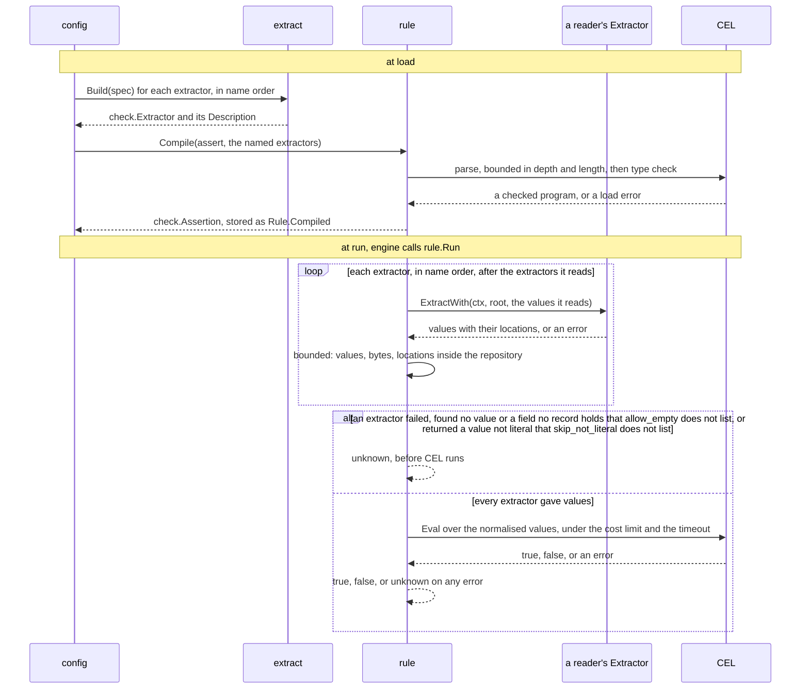
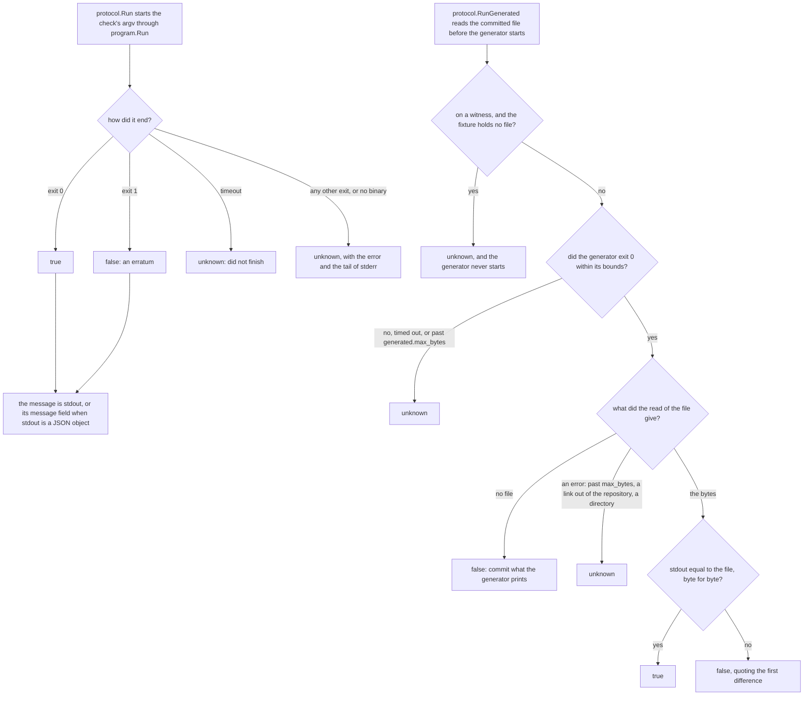
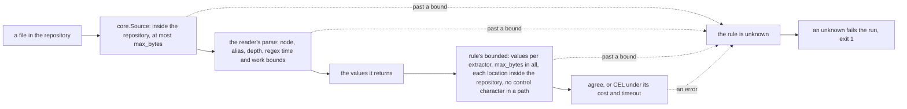
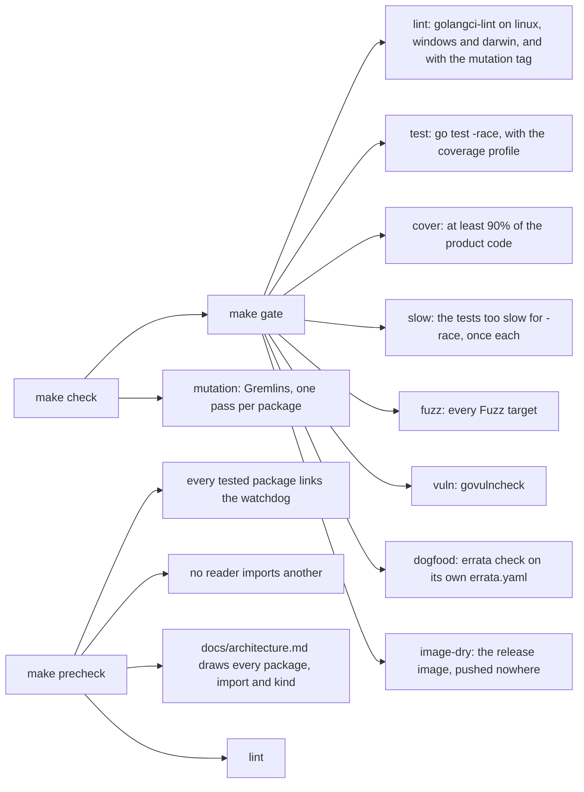

# Architecture

How the code is split, and why. The vocabulary is [GLOSSARY.md](../GLOSSARY.md). The first two
sections cover a whole run; each section after them takes one part of it in more detail.

## Contents

1. [A run, from the config file to a verdict](#a-run-from-the-config-file-to-a-verdict)
2. [The components](#the-components)
3. [Package dependencies](#package-dependencies)
4. [The seams](#the-seams)
5. [The extractor registry and core](#the-extractor-registry-and-core)
6. [The rule layer and CEL](#the-rule-layer-and-cel)
7. [The check protocol](#the-check-protocol)
8. [Bounds, and failing closed](#bounds-and-failing-closed)
9. [Decisions taken in the code](#decisions-taken-in-the-code)
10. [Testing and CI](#testing-and-ci)

## A run, from the config file to a verdict

`errata check` loads `errata.yaml`, runs each check the providers can reach, and prints one
report. The diagram follows one run. A box names the function that does the step.

The exit code is the contract CI reads: 0 when every check that ran found its claim true, 1 on an
erratum, an unknown, or a skip under `--fail-on-skip`, and 2 for bad flags, a config that does not
load, or an `--output` file errata cannot write. `errata list` takes the same load and prints each
check as loaded, defaults filled in, through `report.ListFormats`; it runs nothing. A write that
fails gives exit 2 even when a check failed, since a report errata was asked for is missing.

Each check names its scope. A check whose scope no provider reaches is skipped with its gap,
what the run lacks to reach that scope; [GLOSSARY.md](../GLOSSARY.md) defines provider, gap and
coverage. The text report prints the coverage line, which counts the checks that ran and those
skipped, and lists each skipped check with its gap under it.

A witness (ADR [0015](adr/0015-a-check-names-witnesses-on-which-it-must-report-false.md)) is a
fixture under `.errata/witness/` on which its check must report false. The engine runs the check
again with the fixture as its root (`engine.witness`, `core.OnFixture`): false holds the witness,
true is an erratum, and unknown stays unknown.

## The components

**cli** (`internal/cli`) holds the flags, the wiring and the exit code contract. It loads the
config, hands the checks to the engine, and writes the report in each format asked for. It does
not know how a check runs or how output looks.

**config** (`internal/config`) owns the `errata.yaml` format. It decodes strictly, so an unknown
or misspelt key is a load error, and it builds each check: a program check, a generated check, or
a rule. For a rule it builds every extractor through `extract.Build` and compiles the assert
through `rule.Compile`, so a type error in CEL is a load error too.

**engine** (`internal/engine`) decides which checks run, in what order, and which are skipped. It
runs each check through a function, `engine.Runner`. Production passes `engine.Dispatch`, which
sends each check by its kind to `protocol.Run`, `protocol.RunGenerated` or `rule.Run` (The
seams, 1).

**rule** (`internal/rule`) evaluates a rule. It runs the rule's extractors, holds what they
return to the bounds, and either compares their values (`agree:`) or evaluates the compiled CEL
expression over them (`assert:`). It fails closed: a rule that could not compare anything is
unknown, never true.

**extract and its readers** (`internal/extract` and the packages below it). `extract` is the
facade: the list of extractor kinds, and the `Spec` an `extract:` entry decodes into. Each kind is
a reader in a package of its own, and every reader reads its file through `core`, which holds what
they share: the source inside the repository, the walk, the bounds, the tree and the path
grammar, and git's index.

**protocol and program** (`internal/protocol`, `internal/program`). `protocol` is the check
protocol: run a program and map its exit code to a verdict, or run a generator and compare what it
prints with the committed file. `program` starts every program errata runs, under one timeout,
one output bound and one process group.

**report** (`internal/report`) writes a `check.Report` as text, JUnit or SARIF, and a listing as
text or JSON.

**check** (`internal/check`) holds the domain types that cross every seam above: `Check`, its
`Kind`, `Rule`, `Extractor`, `Value`, `Location`, `Assertion`, `Result` and `Report`. It imports
nothing from errata, so any package can read them.

**provider** (`internal/provider`) is the interface a live system will plug into. It declares
capabilities, which the engine reads to skip a `live` or `applied` check that nothing can reach.
There is no concrete provider yet, so today every such check is skipped.

## Package dependencies

Dependencies point one way: `cli` imports the packages below it, and `check` imports nothing from
errata. `config` imports `extract` and `rule`, because loading a rule builds its extractors and
compiles its assert. `extract` imports one reader package for each kind of extractor, each reader
imports `extract/core`, and no reader imports another, so a reader can become a program of its
own. `rule` owns CEL and imports `check`, `semver` and `minimatch`, nothing else of errata's: it
evaluates over the values its extractors return and never learns how a file is read. `check`
holds the types that cross those seams, `Value`, `Location`, `Extractor` and `Assertion`, so
`rule` and `report` read a value's place without importing `extract`. `report` takes errata's
version as an argument and does not import `cli`.

The two graphs below draw every package under `cmd/` and `internal/` and every import between
them, from the non-test files. An arrow points from the importer to the package it imports. The
first graph is the program's layers; the second opens `extract`, where a box drawn around
packages stands for each of them, so an arrow from the readers' box is an import in every reader.
`TestArchitectureDrawsEveryImport` in `internal/cli` reads both graphs and fails when they and
the code disagree: a package or an import the code has and the graphs leave out, or one they draw
that the code lacks. No non-test file may import a package drawn in a box whose id is `testonly`
(titled "imported only by test files"); the test refuses that title on any other id, and that id
with any other title.

No package imports `heapcap`; only test files built with the `mutation` tag do (Testing and CI).
`protocol` imports `core` to read a generated check's committed file and quote it. `engine`
imports it to read a witness's fixture (`core.OnFixture`). Neither imports a reader.

```mermaid
flowchart TB
    %% packages: TestArchitectureDrawsEveryImport compares this graph with the imports
    extract["internal/extract"]
    subgraph readers ["the readers, one package per kind or pair of kinds"]
        yaml["internal/extract/yaml"]
        json["internal/extract/json"]
        toml["internal/extract/toml"]
        regex["internal/extract/regex"]
        text["internal/extract/text"]
        comment["internal/extract/comment"]
        literal["internal/extract/literal"]
        code["internal/extract/code"]
        markdown["internal/extract/markdown"]
        asciidoc["internal/extract/asciidoc"]
        rst["internal/extract/rst"]
        html["internal/extract/html"]
        marker["internal/extract/marker"]
        xml["internal/extract/xml"]
        ini["internal/extract/ini"]
        properties["internal/extract/properties"]
        toolversion["internal/extract/toolversion"]
        packageversion["internal/extract/packageversion"]
        dependency["internal/extract/dependency"]
        envfile["internal/extract/envfile"]
        gitlabci["internal/extract/gitlabci"]
        shell["internal/extract/shell"]
        githubactions["internal/extract/githubactions"]
        jenkins["internal/extract/jenkins"]
        env["internal/extract/env"]
        filestat["internal/extract/filestat"]
    end
    subgraph below ["below core: core's own, kept apart"]
        clip["internal/extract/core/clip"]
        lineend["internal/extract/core/lineend"]
        gitindex["internal/extract/core/gitindex"]
        lexer["internal/extract/core/lexer"]
    end
    subgraph shared ["below core in the tree: what several readers share"]
        markup["internal/extract/core/markup"]
        mdparse["internal/extract/core/mdparse"]
        htmlparse["internal/extract/core/htmlparse"]
        gomod["internal/extract/core/gomod"]
        litparse["internal/extract/core/litparse"]
    end
    subgraph testonly ["imported only by test files"]
        coretest["internal/extract/coretest"]
        extracttest["internal/extract/extracttest"]
    end
    core["internal/extract/core"]
    check["internal/check"]
    config["internal/config"]
    config --> marker
    extract --> readers
    readers --> core
    readers --> check
    text --> mdparse
    markdown --> markup
    markdown --> mdparse
    asciidoc --> markup
    rst --> markup
    html --> markup
    html --> htmlparse
    marker --> markup
    marker --> mdparse
    core --> clip
    core --> lineend
    core --> gitindex
    core --> lexer
    core --> check
    gitindex --> clip
    gitindex --> check
    markup --> core
    markup --> check
    mdparse --> core
    mdparse --> htmlparse
    htmlparse --> core
    gomod --> core
    toolversion --> gomod
    dependency --> gomod
    litparse --> core
    literal --> litparse
    code --> litparse
    coretest --> core
    extracttest --> check
    extracttest --> lineend
```

The lexer table sits in `core/lexer`, and `core` imports it, so a reader reaches it through `core`.
The comment, marker, literal and code readers read the same rows: `core/litparse`, the parse the
literal and code readers read through, takes a row's string forms and its `Syntax`, and keeps no
table of its own. The code reader reads Go itself, with the standard library's `go/parser` and
`go/constant`, and every other language through `core/litparse`, which reads the members of classes
for it alone. The parses and the selectors that several markup readers share sit in a box of their
own, since they import `core`, while `core` imports the packages of the other box. `config` imports
`marker`, the one reader it names, for the built-in check `errata-unbound-markers`: it walks the
files the rules' marker extractors walk, together, and reports each marker no rule reads.

`TestReadersImportNoOtherReader` in `internal/extract` holds the readers' rule on its own: a
reader imports `core` and no other reader, and `core` imports no reader.

| Package | Owns | Knows nothing about |
|---|---|---|
| `cmd/errata` | `main`: signal handling and the exit code | anything else; it calls `cli.Execute` |
| `internal/cli` | flags, wiring, the exit code contract (0 clean, 1 errata, 2 usage) | how a check runs or how output looks |
| `internal/config` | the `errata.yaml` format, strict decoding, load errors, the line each check starts on; builds each rule's extractors and compiles its assert through `rule.Compile`, so a type error is a load error | running anything |
| `internal/engine` | which checks run, in what order, and which are skipped; the run of each witness on its fixture | the check protocol's details, output formats |
| `internal/protocol` | the check protocol: run a program, map its exit code to a verdict; run a generated check's generator and compare its stdout with the committed file | config, providers, output |
| `internal/program` | starting a program and waiting for it: argv, working directory, environment, stdin, timeout, a bound on each output stream, the kill of the process group | what its exit or its output means; checks, config, output |
| `internal/rule` | evaluating a rule: run its extractors, compare their values or evaluate its assert, fail closed; the CEL environment, the assert helpers, the embedded time zone database and the limits | how an extractor reads a file, config, output |
| `internal/semver` | versions and ranges as npm, Cargo, PEP 440, Go modules and RubyGems write them: their order, precision, satisfaction and overlap, for agree's `compare: semver` and the assert helpers alike | files, rules, CEL |
| `internal/minimatch` | a port of minimatch, the glob matcher Renovate reads a file pattern with, its quirks included, under bounds on brace expansion, nodes, regex source and steps; `rule`'s Renovate helpers match with it | files, rules, CEL |
| `internal/extract` | the kinds of extractor a rule names: the list of kinds, each a reader's `core.Kind` with its `Build`, and the `Spec` a rule's entry decodes into, which finds its kind by key and dispatches `Build`, `Place`, `Resolved` and `Describe` to it | how any kind reads a file; rules, config, output |
| `internal/extract/core` | what every reader shares: the source held inside the repository and to its size cap, the walk of the repository and the directories it passes over, the limits on nodes, values, depth and bytes, the tree and the path grammar with its filters, the line index, quoting, the clocked regex search, the entry extractor and work meter of the INI, properties and env file readers, the files git's index tracks, read without git, and the parse of a manifest under its node limit, which package_version and dependency share | any one format |
| `internal/extract/core/gitindex` | git's index, the list of files a clone holds (ADR [0008](adr/0008-an-extractor-reads-a-file-set-from-git-and-cel-groups-by-file.md)), reachable only through `Index`'s methods, whose every list leaves out the fixtures of witnesses; and the tags on HEAD, read from the refs and objects git writes, which `package_version`'s `tag` reads through core | any reader |
| `internal/extract/core/clip` | cutting file text or a path for a message, kept apart so `gitindex`, which `core` imports, quotes as `core` does | everything else |
| `internal/extract/core/lineend` | the one rule of where a line ends, at a LF, a CRLF or a lone CR, by which every reader numbers its lines and folds its text; `core` hands it on as `LineCursor`, `LineIndex`, `LineOf`, `LastLine`, `LineStart`, `NextLine` and `LineFeeds`, and it is kept apart so `extracttest`, which `core`'s own tests import, counts lines by it too | everything else |
| `internal/extract/yaml`, `internal/extract/json`, `internal/extract/toml` | one reader each that parses its format into core's tree, for core's path to select from | each other |
| `internal/extract/regex` | the regex extractor, which is core's search over the file | the other readers |
| `internal/extract/text` | Markdown prose, searched with core's search | the other readers |
| `internal/extract/comment` | the comments of a source file, found with the lexer table and searched with core's search | the other readers |
| `internal/extract/literal` | the literal data of a file written in a programming language, read through core/litparse's parse and selected with core's path | the other readers; every language's evaluation |
| `internal/extract/code` | the value of one name a source file declares: a Go file's package level const or var, read with go/parser and evaluated with go/constant as the compiler evaluates a constant, and any other language's module level names and class members through core/litparse, with what the program computes marked not literal and a const: that names no constant refused | the other readers; compiling or running the program, and every file of a package but the one it reads |
| `internal/extract/core/litparse` | the parse of literal data the literal and code readers share: the statements at a file's top parsed into core's tree with one grammar, spelt by the lexer table's row, and whatever the file computes marked not literal (ADR [0002](adr/0002-errata-reads-configuration-and-never-runs-it.md)), and for the code reader the members of each class and which names a constant word declares | any one reader; every language's evaluation |
| `internal/extract/core/lexer` | the lexer table, one row per language with its comment delimiters, its string literal forms and heredocs and how each decodes, and for the literal and code readers its syntax of literal data and of classes; and the walk that finds a file's comments and strings in one pass | any one reader |
| `internal/extract/markdown` | a Markdown file's comments, sections under a heading path, fenced code blocks and table cells | the other readers |
| `internal/extract/rst` | a reStructuredText file's comments, sections under a heading path, literal and code blocks and table cells, from a parse of its own | the other readers |
| `internal/extract/core/markup` | what every reader of a document markup shares: the fields a rule writes to pick a comment, section, code block or table cell, their checks, the heading path and the headings it names, and the values a target's pieces give | any one markup |
| `internal/extract/html` | an HTML file's comments, sections under a heading path, pre blocks and table cells | the other readers |
| `internal/extract/asciidoc` | an AsciiDoc file's comments, sections under a heading path, listing, literal and source blocks and table cells, from a parse of its own | the other readers |
| `internal/extract/marker` | the values the markers in the files git tracks tag for one rule, and the markers no rule reads | the other readers |
| `internal/extract/core/htmlparse` | the HTML parse the html, text and markdown readers share: golang.org/x/net/html's tokenizer with each token's offsets from its raw bytes, under a token limit, leaving out what a browser does not show | any one reader |
| `internal/extract/core/gomod` | the go.mod and go.work parse the tool_version and dependency readers share: golang.org/x/mod/modfile, the go command's parser, under a limit on the lines and tokens a file can hold, with a panic in modfile turned into a refusal | any one reader |
| `internal/extract/core/mdparse` | the Markdown parse the text and markdown readers share: goldmark's CommonMark, with GitHub's tables on request, under a guard on its time, nodes and continuations, and the prose that maps text built from the file back to its lines | any one reader |
| `internal/extract/xml` | XML, with an XPath 1.0 subset of its own | the other readers |
| `internal/extract/ini`, `internal/extract/properties` | one reader each of entries for core's entry extractor: INI in the plain, git, ansible, tox and php dialects, and Java properties | each other |
| `internal/extract/envfile` | dotenv files as docker compose reads them, a reader of entries for core's entry extractor, with compose's substitutions resolved from the keys set before | the other readers |
| `internal/extract/shell` | the assignments and defaults of a variable in a shell script, parsed with mvdan.cc/sh/v3 under a guard on the depth of its stack, and the values the shell computes marked not literal | the other readers |
| `internal/extract/jenkins` | the value of an environment variable that a stage of a declarative Jenkinsfile sees, read with a lexer of Groovy's comments and string forms that keeps no statement, and the values Groovy computes marked not literal | the other readers; Groovy's evaluation |
| `internal/extract/toolversion` | the files that pin a tool's version, read by their names: its own line reader, core/gomod's go.mod parse (golang.org/x/mod/modfile), and the JSON and TOML parsers the facade hands it for the manifests and rust-toolchain.toml | the other readers, whose parsers it gets from the facade |
| `internal/extract/packageversion` | the version a package gives itself in each of its manifests (package.json, pyproject.toml, Cargo.toml, a VERSION file), read by the file's name, with the versions the build computes marked not literal | the other readers, whose parsers it gets from the facade |
| `internal/extract/dependency` | one package's version in every manifest and lockfile a rule lists (Go, npm, pnpm, Yarn, Python, Cargo, Bundler, Composer), each file read by the reader its base name chooses, each value marked a range or a resolved version in its origin, and a range rewritten as its tool reads it; a go.mod's module path, go.mod and go.work read through core/gomod's parse; the Gemfile read through core's lexer table | the other readers, whose parsers it gets from the facade, and any registry or package manager |
| `internal/extract/gitlabci` | the value one job of a GitLab CI file sees: local includes, extends, `!reference`, defaults and the variable precedence, read with the YAML parser the facade hands it | the other readers, whose parser it gets from the facade; the network |
| `internal/extract/githubactions` | the value one step or job of a GitHub Actions workflow sees: env: precedence, the matrix's jobs, and the values only GitHub evaluates marked or unknown, read with the YAML parser the facade hands it | the other readers, whose parser it gets from the facade; the network |
| `internal/extract/env` | one variable across the files a rule lists: the reader each file's name or shebang chooses, a glob over git's tracked files, and each value's origin, its reader and its job, step or stage | the readers, which the facade hands it as functions |
| `internal/extract/filestat` | the `exists` and `size` kinds: whether a file is at a name and how many bytes it holds, from core's `Stat`, without opening the file | the other readers |
| `internal/extract/extracttest`, `internal/extract/coretest` | what the extractors' tests share; only test files import them, and Gremlins and the `make cover` total leave them alone | any reader: `coretest` imports `core` alone, and `extracttest` nothing of errata's but `check` and `core/lineend`, since `core`'s own tests import it |
| `internal/provider` | the provider interface, capabilities, the reconciler model, scope gating | any concrete live system (none yet) |
| `internal/report` | output formats: `text`, `junit` and `sarif` for a run, `text` and `json` for `errata list` | where the results came from |
| `internal/heapcap` | the heap watchdog that every package's tests link under the `mutation` tag only | errata's own code: only test files built with the tag import it |
| `internal/check` | the domain types: `Check`, `Rule`, `Extractor`, `Assertion`, `Value`, `Location`, `Extracted`, `Scope`, `Verdict`, `Result`, `Report`, and `ExtractorKind` with the `Description` and `Shape` it gives of what an extractor returns | every other package |

`scripts/casecover`, `scripts/slowtests`, `scripts/clidoc` and `scripts/loccensus` are tools of
the build, run by `make mutation`, `make slow`, `make cli-doc` and `make loc`; errata's binary
does not import them, and the graphs leave them out.

## The seams

Four seams carry the design:

1. **`engine.Runner`.** The engine calls a function to run a check. Production passes
   `engine.Dispatch`, which sends a program check to `protocol.Run`, a generated check to
   `protocol.RunGenerated` and a rule to `rule.Run`, so one run holds all three and prints one
   coverage line; tests pass a fake. The two in `protocol` start their program through one
   function, `program.Run`, so a generator gets a program check's timeout, environment and
   process group, and a plugin's host can start its process the same way without the check
   protocol. A further runner, such as an in-process Kubernetes ownership check, plugs in here
   without the engine changing.
2. **`provider.Provider`.** It declares capabilities, so the engine can skip a `live` or `applied`
   check by name when nothing can reach it. The render, read and predict methods are left out on
   purpose: their signatures should come from the first real provider (Kubernetes), not from a
   guess.
3. **`report.Reporter`.** Text, JUnit and SARIF are three implementations over the same
   `check.Report`; an interactive view would be a fourth. `report.Formats` makes each with
   errata's version, which SARIF writes as the driver's version.
4. **`check.Extractor`.** `extract.Build` turns a spec into one, and `rule` calls it with the
   repository root. A new file format is a new reader, a package under `internal/extract` with a
   `Spec`, a `Build` and a `core.Kind` beside the `Spec` that import `core` and no other reader,
   and one line in the facade's list of kinds; `rule` does not change.

The types on either side of them, and who implements each:

A class shows the fields a seam passes and every method of an interface; a struct's other fields are
left out. `Check`, `Kind`, `Program`, `Generated`, `Rule`, `Extractor` and `Assertion` are in
`check`; `Runner` is `engine`'s, `Provider` is `provider`'s and `Reporter` is `report`'s. Each
reader implements `Extractor`, and `rule` implements `Assertion`.

## The extractor registry and core

A rule's `extract:` entry names one kind by its key, such as `yaml:` or `tool_version:`. Each kind
is declared once, by its reader, as a `core.Kind`: its `Key`, its `Place`, `Resolve` and
`Describe`, and for a reader that the `env` kind asks, its `Env` and `EnvRead`. The facade,
`internal/extract/extract.go`, lists every kind in `kinds`, one line each with the kind's `Build`
and the parsers it is handed. `register` turns each into a `check.ExtractorKind`, and `registry`
builds the table: the kinds in order, each by its key, and the struct an `extract:` entry is
written as, which `config` reads a rule's YAML against.

```mermaid
flowchart LR
    %% kinds: TestArchitectureListsEveryKind compares these keys, in order, with extract.Keys
    subgraph kinds ["kinds in internal/extract/extract.go, one line each"]
        k_yaml["yaml"]
        k_json["json"]
        k_toml["toml"]
        k_regex["regex"]
        k_text["text"]
        k_comment["comment"]
        k_literal["literal"]
        k_code["code"]
        k_markdown["markdown"]
        k_asciidoc["asciidoc"]
        k_rst["rst"]
        k_html["html"]
        k_marker["marker"]
        k_xml["xml"]
        k_ini["ini"]
        k_properties["properties"]
        k_tool["tool_version"]
        k_package["package_version"]
        k_dependency["dependency"]
        k_envfile["envfile"]
        k_gitlab["gitlab-ci"]
        k_shell["shell"]
        k_github["github-actions"]
        k_jenkins["jenkins"]
        k_env["env"]
        k_exists["exists"]
        k_size["size"]
    end
    reader["a reader package declares Kind, a core.Kind of its Spec"] --> kinds
    parsers["the yaml, json and toml readers' parsers"] -.->|"handed to the kinds that read another format"| kinds
    kinds -->|"register"| ek["check.ExtractorKind: Decode, Build, Place, Resolve, Describe"]
    ek -->|"registry"| table["the table: order, byKey, schema"]
    table -->|"the kinds that declare Env"| envreaders["envReaders, which the env kind asks"]
    entry["an extract: entry in errata.yaml"] -->|"Spec.UnmarshalJSON finds the kind by key"| table
    table -->|"extract.Build"| x["check.Extractor"]
```

Two kinds, `exists` and `size`, come from one package, `filestat`. The `env` kind reads one
variable across several files, each with the reader its name or shebang chooses: `envfile`,
`shell`, `gitlab-ci`, `github-actions` and `jenkins` declare themselves env readers, each at an
`Order` of its own, and the facade hands them to `env` as functions, so `env` imports none of them.
A reader that needs another format's parser, such as `tool_version` reading a `package.json`, gets
it from the facade in `core.Parsers` for the same reason. Wherever two kinds must share more than a
parser, the shared code goes below `core`, as `core/gitindex`, `core/clip`, `core/markup`,
`core/mdparse`, `core/htmlparse` and `core/gomod` do, never in a reader.

`core` holds these, in the order a read meets them:

- the `Source`, a file held inside the repository and to its size cap;
- the walk of the repository, and the files git's index tracks (`core/gitindex`), for an
  extractor that reads a set of files;
- the tree a structured reader parses into, and the path grammar with its filters that selects
  from it;
- the clocked regex search that the `regex` and `text` kinds run;
- the entry extractor and its work meter, which `ini`, `properties` and `envfile` read through;
- the line index, which gives each value its line;
- the parse of a JSON or TOML manifest under its node limit (`Source.ParseManifest`), which
  `package_version` and `dependency` read through;
- the limits on nodes, values, depth and bytes that every reader counts against.

## The rule layer and CEL

`config` compiles an assert when the file loads, and `rule` evaluates it when the check runs. The
sequence below is one rule with `assert:`; a rule with `agree:` runs the extractors the same way
and then groups their values instead of calling CEL.

A rule's `allow_empty:` names the extractors that may find no value, or a field no record holds.
`skip_not_literal:` names the extractors whose not literal values, such as `$(cmd)` in a shell
script, are left out rather than make the rule unknown; their literal values are kept. The run also
stops as unknown when its context ends before an extractor runs, or when an assert was not compiled.
Each extractor is a CEL variable whose type the checker knows at load (see the decision linked
below). An extractor may read another's values (ADR
[0010](adr/0010-a-regex-pattern-references-another-extractors-values.md)), so `check.Rule.Order`
runs each after the ones it reads. `agree:` compares the normalised values as text, or as versions
and ranges with `compare: semver` (`internal/semver`); when they differ it blames the values outside
the majority. The types, the bounds on CEL and the reasons for them are in [An assert is CEL,
checked at load and bounded twice](#decisions-taken-in-the-code).

## The check protocol

A program check runs a command and reads its exit code; a generated check (ADR
[0011](adr/0011-a-generated-check-runs-its-generator-and-compares-what-it-prints.md)) runs a
generator and compares what it prints with a committed file. Both start their program through
`program.Run`, with the repository as the working directory, `ERRATA_ROOT`, `ERRATA_CHECK_ID` and
`ERRATA_SCOPE` in the environment, no stdin, the check's timeout, and a process group of its own
that a timeout kills whole.

A program check's output past the bound is cut and the program runs on, since its exit is its
verdict; a generator's output past the bound stops it.

## Bounds, and failing closed

The diagram shows where a read meets each bound, and that every bound it passes ends in an
unknown. [An extractor bounds time and size, and lets memory fail closed](#decisions-taken-in-the-code)
lists the bounds and why each reader and `rule` both check them, and
[A check that cannot evaluate is unknown](#decisions-taken-in-the-code) says why an unknown fails
the run.

## Decisions taken in the code

**cobra for the CLI, not Bubble Tea.** Bubble Tea is a framework for interactive terminal
programs. errata runs in CI first, where there is no terminal, and its contract is an exit code and
a file. cobra is the standard Go command and flag library (kubectl, helm and gh use it). An
interactive view of a report can come later as a `report.Reporter` built on Bubble Tea, without
touching the engine.

**Strict YAML decoding.** `sigs.k8s.io/yaml` with `UnmarshalStrict` rejects an unknown key. A
misspelt `reson:` that the decoder ignored would load a check without its reason, and a misspelt
`scope:` would change what the check needs. Both would fail silently. That library is also the one
`client-go` uses, so the Kubernetes provider adds no second YAML stack. It decodes through
`encoding/json`, which matches `Agree:` to `agree` regardless of case and keeps one of the two when
both are present, so `config` captures the JSON before that decode and refuses a key that differs
from a known one only in case. The library also reads only the first YAML document, so `config`
counts the documents with `go.yaml.in/yaml/v3`'s decoder and refuses a file with a second one
rather than drop the checks after it. A decoder, not a scan of the lines, because only a decoder
knows every line break YAML has and an encoding such as UTF-16; FuzzParse holds the count to what
`go.yaml.in/yaml/v2`, the library's own decoder, reads. The same decoder gives the line each check
starts on, which a SARIF result of a program check points at. yaml/v2 reads YAML 1.1, and the
library turns a bool, a number or null back into a string where the field takes one, so `id: y`
loaded as `true`. `config` walks the yaml/v3 nodes against the types the file decodes into and
decodes each plain scalar in a string field on its own; one that loads as a string other than its
text, such as `y` as `true` or `007` as `7`, is refused.

**A check that cannot evaluate is unknown, and an unknown fails the run.** A crashing program, a
timeout or a missing binary gives `VerdictUnknown`. It is kept apart from the errata, which hold
only claims shown false, and it fails the run all the same (ADR
[0001](adr/0001-an-unknown-fails-the-run-without-being-an-erratum.md)). A skip is only for a scope that no
provider can reach, and the coverage line names each one with its gap. A skip passes the run
unless `--fail-on-skip` sets `check.Report.SkipsFail`; `Report.Failed` then counts it, and each
reporter writes it as a failure, so the output agrees with the exit code.

**A rule's extractors are `check.Extractor` values.** `config` decodes `extract:` into
`extract.Spec` and calls `extract.Build`, so `check` keeps importing nothing from errata and
`rule` evaluates a rule without knowing what file format an extractor reads. Load errors list a
rule's extractors in name order and its verdict messages in the order `agree:` names them, so the
same file gives the same output on every run.

**An assert is CEL, checked at load and bounded twice.** Every extractor is a CEL variable of a
known type, a `list(string)` or, for one whose values come whole, a `list(map(string, dyn))`, so
the checker knows each type when the file loads, and helpers turn strings into numbers, durations
and ports. The parser refuses an expression deeper than 32 or longer than 4096 code points,
because type checking runs before any limit on evaluation. Evaluation runs under a CEL cost of
1,000,000 and a 5 second timeout, which CEL checks after every step of a comprehension. Any error
during evaluation makes the rule unknown, even one that `&&` or `||` would decide around: each of
their operands is rewritten into a hidden note that records an error for that evaluation, and
`exists` and `all` run every member, so the verdict does not depend on the order of the values. A
helper reads at most 1024 bytes. Named time zones come from an IANA database embedded from the Go
toolchain errata is built with, never from the machine, so a verdict is the same on every runner.
depguard holds `internal/rule` and `internal/semver`, which it reads versions with, to an allow
list of imports. Two packages on it can read a file, `time` with `LoadLocation` and `archive/zip`
with `OpenReader`, and forbidigo, not depguard, refuses those two calls.

**An extractor bounds time and size, and lets memory fail closed.** A file in a pull request is
input errata does not control. Every pass over a file is linear in its size or has a bound of its
own, and errata enforces named bounds: the file size (`max_bytes`), a node count scaled from it,
the nodes YAML aliases add, the values per extractor, the depth, the capture groups, the regex
time, the work of a path's filters, the Markdown parse's time and counts, the work of an INI,
properties or env file read, the lines and tokens of a go.mod, and the entries and depth of a walk
of the repository. A file or a walk past a bound makes the rule unknown. Each reader checks its
bounds as it reads and stops early; the rule checks every extractor's values again where they
reach it, against the values per extractor, `max_bytes` bytes in all, and locations that name a
path inside the repository, so a reader that misses a bound, or a plugin, cannot pass one. Peak
memory is not promised, since it depends on a file's shape; a file that exhausts it ends the
process, which fails the job. ADR
[0003](adr/0003-extractors-bound-time-and-size-and-let-memory-fail-closed.md) has the reasons.

**The check protocol is exit codes first.** Exit 0 is true, exit 1 is false, anything else is an
error. Stdout is the message, or the `message` field when stdout is a JSON object. A shell script
can implement this, and so can an existing test suite.

## Testing and CI

`make check` is the gate. Each layer catches a different class of defect.

| Layer | Tool | Where | What it catches |
|---|---|---|---|
| Unit | `go test` | `*_test.go` beside the code | a function that returns the wrong value |
| Property | [rapid](https://pkg.go.dev/pgregory.net/rapid) | `TestProperty*` | an invariant that fails on an input nobody wrote down; rapid shrinks it to the smallest case |
| API | [testscript](https://pkg.go.dev/github.com/rogpeppe/go-internal/testscript) | `internal/cli/testdata/script/*.txtar` | a change to output or exit codes, which are what CI depends on |
| Fuzz | `go test -fuzz` | `Fuzz*` | a panic or a broken invariant on arbitrary bytes from a config, a check's stdout, an extractor's file or path, an assert, or a message embedded in XML or SARIF |
| Mutation | [Gremlins](https://gremlins.dev) | `.gremlins.yaml` | a test that runs code but asserts nothing about it |
| Lint | golangci-lint v2 | `.golangci.yml` | defect classes listed in that file, one comment per linter |
| Vulnerability | govulncheck | `make vuln` | a known CVE in a function errata actually calls |

The gate is a chain of make targets. `make gate` is everything but mutation, `make check` adds
mutation, and `make precheck` runs the few checks that most often sink a gate, in seconds, before
the gate is started:

Tests live beside the code as `_test.go` files, which is the Go convention and gives a test access
to unexported helpers such as `protocol.message`. The API tests in `testscript` run the real
binary.

A property test states a rule about all inputs, for example "the JUnit output is valid XML and its
counts agree with the report, whatever strings a check prints". When rapid finds a counterexample,
copy the shrunk input into an ordinary unit test so it stays fixed.

Gremlins builds the tests with the `mutation` tag and reruns a package's tests once for every
mutant, so a test that takes seconds costs seconds per mutant. That is why each reader is a package
of its own: a mutant of one reader reruns that reader's tests, not every reader's. A test belongs to
the package of the code it checks, so a mutant there is killed where it is: the tests that read
files through every kind to check a bound of `core`, such as the source checks or the path's
filters, are `core`'s external tests (`package core_test`), which import the readers and reach what
only they need through `export_test.go`. Such a test skips under the tag:
`make test` runs it, or `make slow` when it skips under `-race` too. The replay of measured inputs
keeps its cases that stop on the regex clock under the tag, since the clock's counter is a mutant
only they kill.

A mutant that breaks a bound can make a test allocate without limit faster than Gremlins' timeout
fires, and the kernel then kills the whole run. So under the tag each package's tests link
`internal/heapcap`, whose watchdog exits a test binary whose Go heap and stacks pass its cap, and
which bounds each goroutine's stack; Gremlins counts that failure as the mutant killed.
`TestEveryTestedPackageLinksTheWatchdog` holds every package with tests to the link, and
`.gremlins.yaml` leaves the watchdog unmutated.

`make mutation` judges each package alone, the facade, `core` and every reader each in a pass of
its own, so a mutant of a reader counts as killed only when that reader's own tests fail. The
thresholds are 85% efficacy and 85% mutant coverage. Go's coverage profile has no block for a case
expression, only for its clause's body, so `scripts/mutation.sh` runs `scripts/casecover` on
Gremlins' coverage profile: a case expression whose clause body a test ran gets a covered block,
and Gremlins mutates it like any other line. The coverage figure is still not 100%, because the
profile also leaves package-level declarations and code after a statement's first func literal
outside every block. Where such mutants cap a package, its floor is the figure it reaches;
`scripts/mutation-floors.txt` has each package's floors and the count behind a lowered one.

CI's test job runs `make gate` with fuzzing scoped to the packages a push changed, and its
mutation job mutates the lines those packages changed; a weekly pass runs every package whole.

Three tests in `internal/cli`, in `make test` and `make precheck`, fail when this document and
the code disagree. `TestArchitectureDrawsEveryImport` holds the package graphs to the imports,
`TestArchitectureTablesEveryPackage` the package table to the packages, and
`TestArchitectureListsEveryKind` the registry diagram to the kinds in
`internal/extract/extract.go`.
